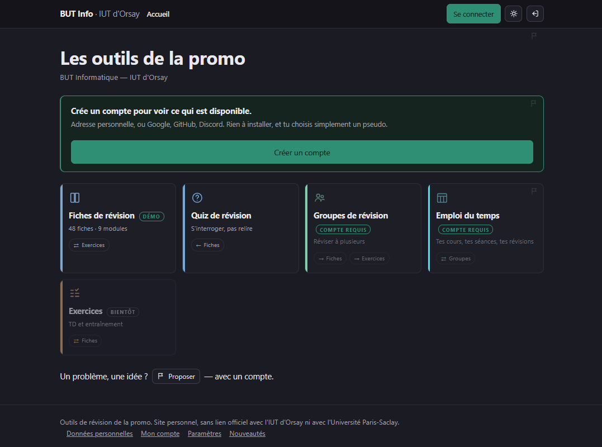

# Portail BUT Info

Plateforme web collaborative pour une promotion de BUT Informatique : un
**portail** qui réunit plusieurs applications sous une connexion unique, et
sur lequel d'autres développeurs branchent leurs propres outils.

> **Ce dépôt est une vitrine.** Le projet complet vit dans un dépôt privé,
> parce qu'il contient le contenu publié, le schéma de la base de données en
> production et la documentation interne. On trouve ici le code qui montre
> comment la plateforme est construite, et un module d'exemple complet pour
> voir la chaîne de fiches fonctionner.



---

## Ce que fait la plateforme

| Application | Ce qu'elle permet |
|---|---|
| **Fiches de révision** | des fiches imprimables au format A5, classées par semestre et par module, avec recherche, thème clair/sombre et version livret à plier en carnet |
| **Quiz** | s'interroger sur les fiches ; une session se met en pause et se reprend sur un autre appareil |
| **Groupes de révision** | discussion en direct, séances planifiées, invitations par lien, rôles au sein du groupe, signalement des messages |
| **Messagerie privée** | chiffrée de bout en bout ; clés protégées par passkey, phrase de sauvegarde, transfert de clés d'un appareil à l'autre |
| **Emploi du temps** | import et synchronisation de calendriers ICS, séances des groupes intégrées |
| **Notifications** | notifications push (Web Push, VAPID) pour les messages, les séances et les rappels |

Une **administration** gère les demandes d'accès, les rôles, les signalements
et les propositions envoyées depuis n'importe quelle page du site.

## Une plateforme ouverte à d'autres développeurs

Chaque outil reste chez la personne qui l'écrit : son dépôt, son déploiement,
son rythme. Le portail leur prête trois choses :

- **un sous-domaine** et une carte sur la page d'accueil, sans distinction
  visuelle selon l'auteur ;
- **la session commune** : le cookie de connexion couvre tous les
  sous-domaines, et un outil demande qui est connecté à `GET /api/moi`, sans
  aucun secret à conserver ;
- **un vocabulaire commun** : chaque outil publie un index JSON de ses
  ressources, rattachées à un code de module et à un numéro de fiche. Un
  exercice publié par un autre outil apparaît ainsi tout seul sur la fiche
  qui lui correspond, au chargement de la page.

Le registre des outils tient dans un seul fichier, [`apps.json`](apps.json) :
ajouter un outil, c'est ajouter une entrée. Le contrat complet (formats,
en-têtes CORS, garde-fous) est décrit dans
[`docs/integration-outils.md`](docs/integration-outils.md).

## Architecture

```
                 ┌─────────────────────────────┐
  navigateur ──▶ │  Cloudflare Pages           │
                 │  ├─ site statique généré    │──▶  outils des autres
                 │  └─ Functions (API, accès)  │     développeurs
                 └──────────────┬──────────────┘     (sous-domaines)
                                │
                                ▼
                 ┌─────────────────────────────┐
                 │  Supabase / PostgreSQL      │
                 │  règles d'accès par rôle    │
                 │  temps réel                 │
                 └─────────────────────────────┘
```

- **Le site est généré, pas écrit à la main.** `build_site.py` lit les mêmes
  sources que la chaîne de fiches et produit toutes les pages, sans framework.
- **L'API** tourne sur Cloudflare Pages Functions (`functions/`) : un
  middleware vérifie la session et le rôle avant de servir une zone protégée.
- **La base** est sur Supabase ; les droits sont posés au niveau des lignes
  (Row Level Security), et chaque requête est tranchée par la base sous le
  rôle de l'utilisateur.
- **Le chiffrement** des messages privés se fait dans le navigateur
  (Web Crypto) : le serveur ne voit jamais le texte clair.

## Pile technique

Python · JavaScript (sans framework) · HTML/CSS · Cloudflare Pages Functions ·
Supabase (PostgreSQL, Auth, Realtime) · Web Crypto · WebAuthn (passkeys) ·
Web Push · Chrome headless, pypdf et reportlab pour les PDF

## Contenu du dépôt

```
├── build.py              chaîne de fiches : HTML → PDF A5 avec pied de page
├── livret.py             réordonne un PDF pour l'imprimer en carnet
├── build_site.py         génère le site complet
├── ossature.py, zones.py, documents.py
│                         les blocs du générateur
├── carte.py, carte_site.py
│                         extraient du code la carte interactive du projet
├── apps.json             le registre des outils du portail
├── assets/               gabarit des fiches, styles et scripts du site,
│                         chiffrement, authentification
├── functions/            l'API (Cloudflare Pages Functions)
├── modules/BIO.json      un module d'exemple
├── content/BIO/          sa fiche : la division cellulaire
└── docs/                 le guide d'intégration, des captures d'écran
```

## Essayer la chaîne de fiches

```bash
pip install pypdf reportlab
python build.py BIO --sortie sortie/
python livret.py sortie/Fiche_BIO_01_La_division_cellulaire.pdf
```

Il faut Google Chrome, Chromium ou Edge (moteur de rendu PDF, détecté
automatiquement) et les polices DejaVu installées sur le système.

Une fiche s'écrit en HTML **purement sémantique** : encadrés définition,
méthode, piège et exemple, tableaux, schémas en SVG. Toute la mise en forme
vient d'un seul gabarit, [`assets/fiche.css`](assets/fiche.css). Le
générateur ajoute la couverture, le sommaire, le repère dans la collection,
la typographie française et le pied de page paginé, et veille à ce qu'aucun
bloc ne soit coupé entre deux pages.

## Ce qui reste dans le dépôt privé

- le contenu publié (fiches, banque de questions du quiz) ;
- les migrations de la base et ses règles d'accès ;
- le **banc d'essai** du comportement : il rejoue les migrations sur PGlite
  (PostgreSQL compilé en WebAssembly), appelle les routes de l'API comme
  Cloudflare les appelle et exécute le JavaScript des pages sous jsdom.
  Chaque essai est doublé d'un **témoin**, la même chose cassée exprès, qui
  doit échouer : un essai qui n'a jamais échoué ne prouve rien ;
- le journal de conception, qui garde la trace de chaque décision.

## Auteur

Christophe De Almeida, étudiant en BUT Informatique · GitHub :
[@Orangetleman](https://github.com/Orangetleman)
